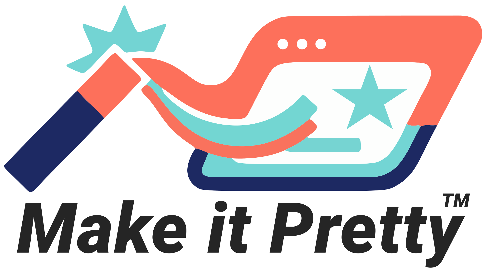
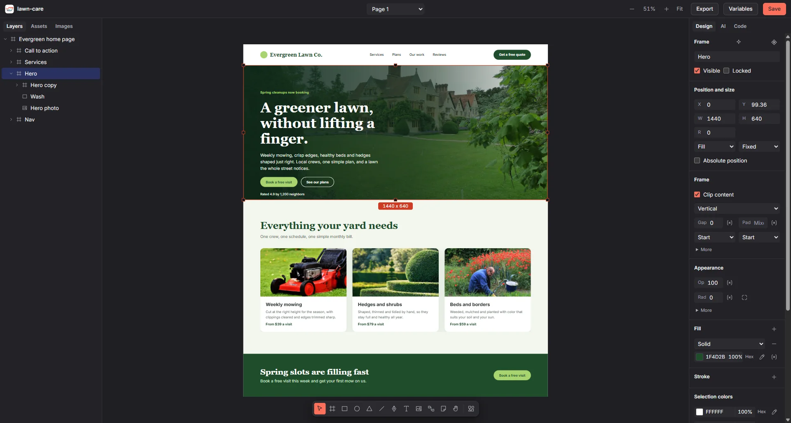
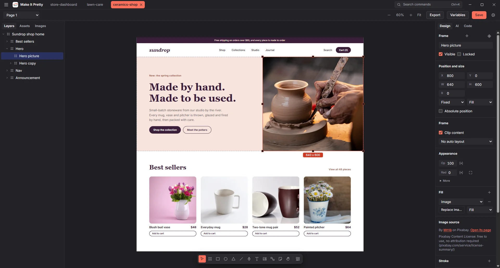
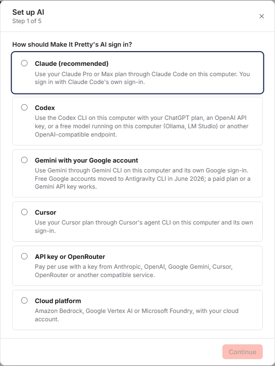
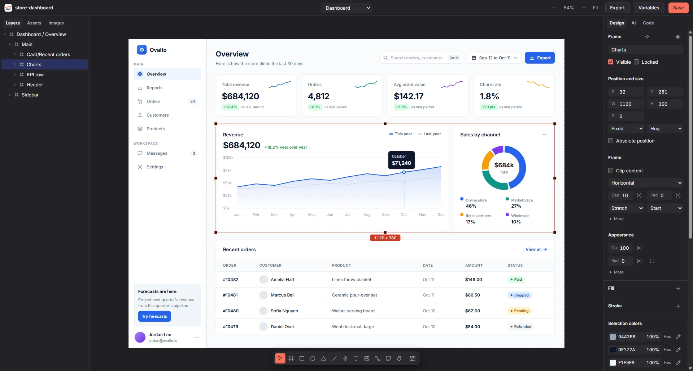

<p align="center">
  
</p>

<p align="center">
  <a href="https://github.com/dtsoden/makeitpretty-app/releases"></a>
  <a href="https://github.com/dtsoden/makeitpretty-app/releases/latest"></a>
  <a href="https://github.com/dtsoden/makeitpretty-app/stargazers"></a>
</p>

# Plain English in. Beautiful designs out.

Make It Pretty™ is a free design app for Windows and Mac. Describe what you want and your AI designs it: Claude, ChatGPT, Gemini or Cursor, inside the app or from your coding tool through its built-in MCP server. Then you make it pretty on the canvas. No agent limits, no seats, no account.

Website: [makeitpretty.app](https://makeitpretty.app)



## Download

| | |
|---|---|
| Windows 10 and 11 (64-bit) | [Download for Windows](https://makeitpretty.app/download/windows) |
| Mac with Apple silicon | [Download for Apple silicon](https://makeitpretty.app/download/mac-arm) |
| Mac with Intel | [Download for Intel Mac](https://makeitpretty.app/download/mac-intel) |

Every installer is code-signed, and the Mac versions are notarized by Apple. The app updates itself. All files and release notes are on the [Releases](https://github.com/dtsoden/makeitpretty-app/releases/latest) page.

## Like it? Star this repo

Stars help other people find Make It Pretty. If it saves you time, click **Star** at the top of this page.

## What it does

- **Your AI, unmetered.** No agent days, MCP call limits or image caps. You pay for the AI plan you already have, and nothing else.
- **Works with the window closed.** The engine waits in your system tray or menu bar, so agents design without the app open and without a trip through anyone's cloud.
- **Real pictures at no cost.** Pixabay photos, illustrations and vector art go straight into your designs, placed by you or your agent, with your own free key.
- **Bring your work with you.** Open Figma `.fig` files and pen.dev `.pen` files, or paste frames straight from Figma.
- **From design to code.** Any frame becomes HTML with CSS or Tailwind, or a React component. Export PNG, SVG, PDF, JPEG or WebP.
- **A full design tool.** Components and variables with light and dark modes, auto layout, a pen tool, icons, slides, shader fills, templates and style guides.
- **Private by design.** No account and no telemetry. Agents reach the app through a private channel on your computer, and your designs stay there.



## AI inside the app, on your own plan

The AI tab signs in the way you already pay for AI: your Claude Pro or Max plan through Claude Code, ChatGPT through Codex, an API key, OpenRouter, a cloud account, or a free local model with Ollama or LM Studio.

<p align="center"></p>

## Connect your coding agent

In the app's AI tab, open Settings and choose Claude Code, Claude Desktop, Cursor, Codex or Gemini CLI. The app shows the exact change to that tool's settings and backs the file up first. Or add it by hand to any MCP client:

Windows

```json
{
  "mcpServers": {
    "make-it-pretty": {
      "command": "C:\\Users\\you\\AppData\\Local\\Programs\\Make It Pretty\\resources\\bin\\makeitpretty.exe",
      "args": ["--mcp"]
    }
  }
}
```

Mac

```json
{
  "mcpServers": {
    "make-it-pretty": {
      "command": "/Applications/Make It Pretty.app/Contents/Resources/bin/makeitpretty",
      "args": ["--mcp"]
    }
  }
}
```



## Help and feedback

Found a problem or have an idea? [Open an issue](https://github.com/dtsoden/makeitpretty-app/issues).

Make It Pretty is a trademark of David Soden. This repository holds the releases; the app is free to download and use.
